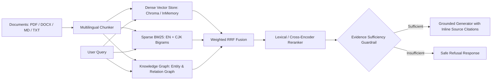

# ⚡ VeloRAG v0.3

**Production-Grade Hybrid RAG Framework with Multilingual Knowledge Graph, Grounded `[Source N]` Citations, Refusal Guardrails & Agent Canvas**

[](LICENSE)
[](https://www.python.org)
[](https://fastapi.tiangolo.com)

> **VeloRAG** 是一套面向高校科研、医疗 AI 规范问答与企业知识库场景的**生产级混合检索增强生成（Hybrid RAG）与 Agent Canvas 编排框架**。原生支持中英双语词法+稠密向量+多跳知识图谱融合检索、行内 `[Source N]` 证据溯源、无依据拒答护栏（Evidence-Sufficiency Refusal Guardrail）以及内置自动化评测套件。

---

## ✨ 核心特性 (Key Highlights)

1. **三路混合检索 + 加权 RRF 融合 (`velorag.retrieval`)**
   - **Dense Vector Search**：支持 `SentenceTransformers`、`OpenAI Embeddings` 以及零外部依赖的确定性特征哈希嵌入器（`HashEmbedder`），断网/无 GPU 环境开箱即用。
   - **Multilingual Sparse BM25**：原生支持英文词干与中文 CJK 单字 + 双字 Bigram 切词（`tokenize_multilingual`），解决传统正则分词在中文场景完全失效的问题。
   - **Multi-Hop Knowledge Graph (`velorag.graph`)**：自动从文档切块中抽取中英文专有名词、领域术语、大写缩写与主谓宾语义关系，通过跳数衰减权重 $\frac{1}{1 + 0.35 \times \text{hop}}$ 注入加权 Reciprocal Rank Fusion (RRF)。

2. **可验证行内引用 `[Source N]` 与无依据拒答护栏 (`velorag.generation`)**
   - **Pre-Generation Guardrail**：在调用生成模型前自动计算检索最高分与中英双语关键词重合度，当上下文证据不足或遇到无关/过期陷阱问题时**主动拒答**，杜绝幻觉。
   - **Structured Citation Extraction**：强制约束并在后处理阶段解析 `[Source N]` 标记，返回带精确原文摘录（`quote`）、文档来源（`source`）和相关性分数的结构化 `Citation` 列表。
   - **Offline Extractive Fallback**：未配置外部 LLM API Key 时自动启用基于句级证据评分的抽取式带引用生成，保证本地开发与 CI 100% 可复现。

3. **Agent Canvas DAG 可视化工作流引擎 (`velorag.agent`)**
   - 支持 `Begin`、`Retrieval`、`Rerank`、`Switch`（条件分支/证据阈值守卫）、`Code`（受控 Python 数据转换）、`Tool`、`Generate`、`End` 八类节点。
   - 支持 JSON 拓扑序列化/反序列化（`to_dict` / `from_dict`）与逐节点毫秒级执行轨迹（`trace`）追踪。

4. **内置 RAG 检索与引用/拒答评测套件 (`velorag.eval`)**
   - 内置**校园与 AI 开源实验室双语基准数据集**（涵盖研究生学籍手册、Slurm 算力集群指南、医疗 AI 联培数据合规、差旅报销及无依据拒答陷阱样本）。
   - 一键评测 `Recall@K`、`MRR@K`、`NDCG@K`、`Citation Precision`、`Keyword Coverage`、`Refusal Accuracy` 与平均延迟，并直接输出 Markdown 对比表格。

---

## 🏗️ 系统架构 (Architecture)



---

## 🚀 快速开始 (Quick Start — 零外部依赖 3 分钟跑通)

### 1. 安装

```bash
git clone https://github.com/yunyancuo/velorag.git
cd velorag
pip install -e ".[dev]"
```

### 2. 运行内置基准评测 (`velorag eval`)

无需配置 Redis、GPU 或 OpenAI Key，直接运行内置的校园与科研知识库评测基准：

```bash
velorag eval --top-k 3
```

示例输出（内置 5 篇中英校园/医疗AI科研制度文档、8 条含跨语言多跳与无依据拒答陷阱的测试样本）：

| Mode | Recall@3 | MRR@3 | NDCG@3 | Citation Precision | Keyword Hit | Refusal Acc | Avg Latency (ms) |
| :--- | :---: | :---: | :---: | :---: | :---: | :---: | :---: |
| `dense` | 100.00% | 100.00% | 98.66% | 100.00% | 100.00% | 100.00% | 0.55 |
| `sparse` | 91.67% | 100.00% | 93.55% | 100.00% | 91.67% | 100.00% | 0.47 |
| `hybrid` | 91.67% | 100.00% | 93.55% | 100.00% | 91.67% | 100.00% | 0.53 |
| `graph_enhanced` | **100.00%** | **100.00%** | **100.00%** | **100.00%** | **100.00%** | **100.00%** | **0.50** |

### 3. Python SDK 极简调用

```python
from velorag import VeloRAG

rag = VeloRAG()
rag.ingest_text(
    text="硕士研究生培养体系要求总学分不少于32学分，其中学位必修课不少于18学分。",
    source="研究生培养手册_2026.pdf",
)

# 1. 有据可查的问题 -> 自动附带 [Source 1] 引用
ans = rag.query("硕士研究生毕业总学分要求不少于多少学分？")
print(ans.content)        # "... [Source 1]"
print(ans.refused)        # False
print(ans.citations[0])   # Citation(index=1, source='研究生培养手册_2026.pdf', ...)

# 2. 超出知识库范围的问题 -> 触发拒答护栏
trap = rag.query("请问第三食堂夜宵麻辣烫几点关门？")
print(trap.refused)       # True
print(trap.content)       # "抱歉，当前知识库中没有找到与该问题直接相关的可靠依据..."
```

### 4. Agent Canvas DAG 编排示例

```python
import asyncio
from velorag.agent import AgentCanvas

async def main():
    canvas = AgentCanvas.create_default_rag_canvas("default")
    ctx = await canvas.run("AI开源实验室算力集群使用什么调度系统？")
    print("Answer:", ctx.final_answer)
    print("Trace:", ctx.trace)

asyncio.run(main())
```

### 5. 启动全栈服务 (FastAPI + React Studio)

```bash
# 启动后端 API (默认自动初始化 SQLite 并预置校园与科研知识库语料)
velorag serve --port 8000

# 启动前端工作台
cd frontend
npm install
npm run dev
```

访问 `http://localhost:8000/docs` 查看交互式 OpenAPI 文档，或访问前端控制台体验 **Knowledge Bases**、**Grounded QA & Graph**、**Agent Canvas** 与 **Eval Benchmark**。

---

## 🔬 检索算法实验

研究分支新增 `local_residual` / `residual_hybrid`，实现受 NEAR 启发的单层邻域残差检索。
首轮真实 BGE + SciFact 小试**未证明残差质量收益**，因此保留为可选实验模式。
具体算法、公开数据、原始结果和复现命令见 [邻域残差小试](docs/research/002-residual-pilot.md)。
这版实现使用精确搜索与全量重建，尚未证明大知识库收益或原创性。

## 🧪 运行测试 (Testing)

```bash
pytest -v
```

---

## 📄 开源协议 (License)

Apache License 2.0
