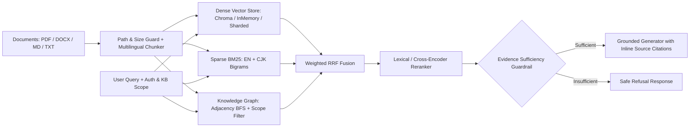

# ⚡ VeloRAG v0.3

**Production-Grade Hybrid RAG Framework with Multilingual Knowledge Graph, Grounded `[Source N]` Citations, Refusal Guardrails, Multi-Tenant Isolation & Agent Canvas**

[](#开源协议-license)
[](https://www.python.org)
[](https://fastapi.tiangolo.com)

> **VeloRAG** 是一套面向高校科研、医疗 AI 规范问答与企业知识库场景的**旗舰级、生产级混合检索增强生成（Hybrid RAG）与 Agent Canvas 编排框架**。原生支持中英双语词法 + 稠密向量 + 多跳知识图谱融合检索、行内 `[Source N]` 证据溯源、无依据拒答护栏（Evidence-Sufficiency Refusal Guardrail）、多租户知识库隔离以及内置自动化评测套件。

---

## ✨ 核心特性 (Key Highlights)

1. **三路混合检索 + 加权 RRF 融合 (`velorag.retrieval`)**
   - **Dense Vector Search**：支持 `SentenceTransformers`、`OpenAI Embeddings` 以及零外部依赖的确定性特征哈希嵌入器（`HashEmbedder`），采用先过滤后截断策略避免多租户漏召回。
   - **Multilingual Sparse BM25**：原生支持英文词干与中文 CJK 去停用字 unigram + bigram 切词（`tokenize_multilingual`），解决传统正则分词在中文场景失效的问题。
   - **Multi-Hop Knowledge Graph (`velorag.graph`)**：自动从文档切块中抽取中英文专有名词、领域术语、大写缩写与主谓宾语义关系，基于 $O(V + E)$ 邻接表多跳遍历与跳数衰减权重 $\frac{1}{1 + 0.35 \times \text{hop}}$ 注入加权 Reciprocal Rank Fusion (RRF)，并支持租户级子图过滤隔离。

2. **可验证行内引用 `[Source N]` 与无依据拒答护栏 (`velorag.generation`)**
   - **Pre-Generation Guardrail**：在调用生成模型前自动计算检索最高分与中英双语关键词重合度，当上下文证据不足或遇到无关/过期陷阱问题时**主动拒答**，杜绝幻觉。
   - **Structured Citation Extraction**：强制约束并在后处理阶段解析 `[Source N]` 标记，返回带精确原文摘录（`quote`）、文档来源（`source`）和相关性分数的结构化 `Citation` 列表。
   - **Offline Extractive Fallback**：未配置外部 LLM API Key 时自动启用基于句级证据评分的抽取式带引用生成，保证本地开发与 CI 100% 可复现。

3. **安全多租户隔离与认证体系 (`velorag.auth`, `velorag.knowledge`)**
   - 基于 `bcrypt` 密码哈希与算法白名单（`HS256`/`HS384`/`HS512`）JWT + 带前缀 API Key 认证，彻底防范 `alg=none` 与弱密钥风险。
   - `kb_id` 与多维度元数据过滤器贯穿 **Dense / Sparse / Hybrid / Graph / Query / Chat / Agent Canvas** 全链路，支持私有知识库与公开知识库细粒度权限隔离。
   - 文件上传内置路径穿越清洗、扩展名白名单、流式体积上限（默认 10 MB）防护。

4. **Agent Canvas DAG 可视化工作流引擎 (`velorag.agent`)**
   - 支持 `Begin`、`Retrieval`、`Rerank`、`Switch`（条件分支/证据阈值守卫）、`Code`（基于白名单 AST 的受控安全求值器）、`Tool`、`Generate`、`End` 八类节点。
   - 支持静态/运行期 DAG 环路检测、孤立节点诊断、JSON 拓扑序列化/反序列化（`to_dict` / `from_dict`）与逐节点毫秒级执行轨迹（`trace`）追踪。

5. **内置 RAG 检索与引用/拒答评测套件 (`velorag.eval`)**
   - 内置**校园与 AI 开源实验室双语基准数据集**（涵盖研究生学籍手册、Slurm 算力集群指南、医疗 AI 联培数据合规、差旅报销及无依据拒答陷阱样本）。
   - 一键评测 `Recall@K`、`MRR@K`、`NDCG@K`、`Citation Precision`、`Keyword Coverage`、`Refusal Accuracy` 与平均延迟，并直接输出 Markdown 对比表格。

---

## 🏗️ 系统架构 (Architecture)



---

## 🔌 核心 REST API 概览

所有 v1 接口挂载于 `/api/v1`（交互式文档见 `http://localhost:8000/docs`）：

| 模块 | 方法与路径 | 说明 |
| :--- | :--- | :--- |
| **System** | `GET /health`, `GET /api/v1/stats` | 健康检查（含数据库探活）与索引/图谱统计 |
| **Auth** | `POST /api/v1/auth/register`, `/login`, `GET /me`, `/api-keys` | 用户注册、JWT 登录与 `vr-` API Key 管理 |
| **Knowledge** | `GET/POST /api/v1/knowledge`, `GET/PUT/DELETE /{kb_id}` | 多租户知识库 CRUD（登录用户创建默认私有） |
| **Documents** | `POST/GET /api/v1/knowledge/{kb_id}/documents`, `POST /{kb_id}/texts` | 安全文件上传/文本入库与文档状态查询 |
| **Search & QA** | `POST /api/v1/search`, `POST /api/v1/query`, `GET /api/v1/graph` | 带 `kb_id` 与多租户权限收敛的检索、引用问答与图谱子图 |
| **Chat** | `POST/GET/DELETE /api/v1/chat/sessions`, `POST /{id}/messages` | 绑定知识库作用域的多轮溯源对话 |
| **Agent Canvas** | `GET/POST/DELETE /api/v1/agents`, `POST /{id}/run` | DAG 工作流拓扑校验、持久化与执行轨迹追踪 |
| **Evaluation** | `GET /api/v1/eval/dataset`, `POST /api/v1/eval/run` | 一键运行四路检索与拒答评测基准 |

---

## 🚀 快速开始 (Quick Start — 零外部依赖 3 分钟跑通)

### 1. 安装

```bash
git clone https://github.com/yunyancuo/velorag.git
cd velorag
pip install -e ".[dev]"
```

### 2. 运行内置基准评测 (`velorag eval`)

无需配置 Redis、GPU 或 OpenAI Key，直接运行内置的校园与科研知识库评测基准：

```bash
velorag eval --top-k 3
```

示例输出（内置 5 篇中英校园/医疗 AI 科研制度文档、8 条含跨语言多跳与无依据拒答陷阱的测试样本）：

| Mode | Recall@3 | MRR@3 | NDCG@3 | Citation Precision | Keyword Hit | Refusal Acc | Avg Latency (ms) |
| :--- | :---: | :---: | :---: | :---: | :---: | :---: | :---: |
| `dense` | 100.00% | 100.00% | 98.66% | 100.00% | 100.00% | 100.00% | 0.55 |
| `sparse` | 91.67% | 100.00% | 93.55% | 100.00% | 91.67% | 100.00% | 0.47 |
| `hybrid` | 91.67% | 100.00% | 93.55% | 100.00% | 91.67% | 100.00% | 0.53 |
| `graph_enhanced` | **100.00%** | **100.00%** | **100.00%** | **100.00%** | **100.00%** | **100.00%** | **0.50** |

### 3. Python SDK 极简调用

```python
from velorag import VeloRAG

rag = VeloRAG()
rag.ingest_text(
    text="硕士研究生培养体系要求总学分不少于32学分，其中学位必修课不少于18学分。",
    source="研究生培养手册_2026.pdf",
    metadata={"kb_id": "campus"},
)

# 1. 有据可查的问题 -> 自动附带 [Source 1] 引用（支持 kb_id 过滤）
ans = rag.query(
    "硕士研究生毕业总学分要求不少于多少学分？",
    filters={"kb_id": "campus"},
)
print(ans.content)        # "... [Source 1]"
print(ans.refused)        # False
print(ans.citations[0])   # Citation(index=1, source='研究生培养手册_2026.pdf', ...)

# 2. 超出知识库范围的问题 -> 触发拒答护栏
trap = rag.query("请问第三食堂夜宵麻辣烫几点关门？", filters={"kb_id": "campus"})
print(trap.refused)       # True
```

### 4. Agent Canvas DAG 编排示例

```python
import asyncio
from velorag.agent import AgentCanvas

async def main():
    canvas = AgentCanvas.create_default_rag_canvas("default")
    ctx = await canvas.run("AI开源实验室算力集群使用什么调度系统？")
    print("Answer:", ctx.final_answer)
    print("Trace:", ctx.trace)

asyncio.run(main())
```

### 5. 启动全栈服务 (FastAPI + React Studio)

```bash
# 启动后端 API (默认自动初始化 SQLite 并预置校园与科研知识库语料)
velorag serve --port 8000

# 启动前端工作台
cd frontend
npm install
npm run dev
```

访问 `http://localhost:8000/docs` 查看交互式 OpenAPI 文档，或访问前端控制台体验 **Knowledge Bases**、**Grounded QA & Graph**、**Agent Canvas** 与 **Eval Benchmark**。

---

## 🐳 Docker 部署与安全配置

生产部署前请先复制环境变量模板并替换强密码与随机密钥：

```bash
cp .env.example .env
# 编辑 .env，设置至少 32 位高强度 VELORAG_SECRET_KEY 与 POSTGRES_PASSWORD
docker compose up -d --build
```

关键安全环境变量说明：

| 环境变量 | 默认值 | 说明 |
| :--- | :--- | :--- |
| `VELORAG_ENV` | `development` | 设为 `production` 时强制禁止使用默认开发 JWT 密钥 |
| `VELORAG_SECRET_KEY` | 开发默认值 | JWT 签名密钥（长度 ≥ 16，生产环境建议 32+ 随机字符） |
| `VELORAG_JWT_ALGORITHM` | `HS256` | 仅允许 `HS256` / `HS384` / `HS512` 白名单算法 |
| `VELORAG_CORS_ORIGINS` | 本地开发源 | 逗号分隔的允许跨域源列表 |
| `VELORAG_MAX_UPLOAD_MB` | `10` | 单文件上传最大体积限制（MB） |
| `VELORAG_ALLOWED_INGEST_ROOT` | `VELORAG_DATA_DIR` | `/ingest` 接口允许读取的本地安全根目录 |

---

## 🧪 开发与质量校验 (Development & Testing)

```bash
# 后端代码风格检查与全量测试
ruff check src tests
pytest -v

# 前端类型检查与生产构建
cd frontend
npm ci
npx tsc --noEmit
npm run build
```

---

## 📄 开源协议 (License)

Apache License 2.0（详见 `pyproject.toml` 声明）
