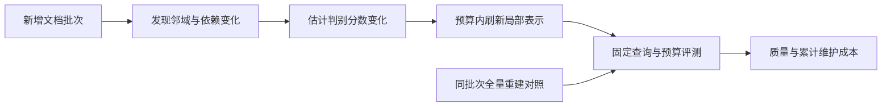

# VeloRAG 差异化研究记录

_2026-10-20；状态：研究假设与小试提案；负责人：项目用户；AI 辅助构思与核查。_

---

## 🎯 用户目标与边界

用户原话：“我要用一套新算法解决大知识库检索效果差的问题。”
补充约束：“没有，但你做的要和市面上的 rag 产品不一样。”

目前没有真实业务语料。研究可以从公开数据开始；目标规模、语言、行业和算力尚未确定。
现有应用用于验证算法。候选机制、产品定位和已验证成果在本文中分别标记。

**候选产品定位：** 随着知识库持续增长，识别新增内容造成的检索混淆，按维护预算修复受影响的判别索引，并展示质量与维护成本的变化。
这是拟验证的差异化，不是现有功能，也不是已确认的原创贡献。

## 🔎 已有能力与相近工作

本轮只检查了公开资料中的代表项目，不是市场全量调查，也没有运行第三方产品。
产品支持的内容不能被表述成“我们独有”：

| 已有项目 | 本轮核对到的公开能力 | 对本项目的约束 |
| --- | --- | --- |
| Dify | 知识流水线、语义/关键词/混合检索、重排、元数据与引用[^1] | 这些属于实现与对照基础 |
| PageIndex | 文档树与推理式导航，也公开了跨文档树索引方向[^2] | “树检索”或“无向量”本身不能作为创新 |
| LightRAG | 图与向量结合、双层检索、增量更新[^3] | “图谱 + 混检 + 增量”仍不足以建立差异 |

更直接的算法挑战：

| 相近工作 | 已有机制 | 对候选方向的挑战 |
| --- | --- | --- |
| NEAR，2026-10-09 | 邻域参考与残差表示，固定索引中的单次 ANN[^4] | 邻域去共性、突出区别已经有直接工作 |
| CEE，2026-09-07 | 邻域对比 facets、证据条件化探索、覆盖选集[^5] | 对比证据和缺口驱动补搜不能直接宣称新颖 |
| AdaGATE | 在 token 预算下追踪缺失桥接证据并修复证据集合[^6] | “缺什么补什么”已有明确先例 |
| FreshDiskANN | 流式更新下维护 ANN 图索引[^7] | 几何近邻维护不等于语义相关性提升 |
| 增量 semantic substrate 研究 | 增量维护与全量重建的成本比较[^8] | “维护成本随变化量增长”也是已有研究方向 |
| AURORA | 持续索引、分布漂移与低成本适配[^9] | 仅检查摘要；正文可能覆盖更接近的机制，必须继续核对 |

NEAR 和 CEE 的全文检查由两份独立 AI 分析分别进行；两份分析都指出了初始构想与既有工作的重合。
这不是独立实验复现，也不代表专家共识。

## 💡 构思记录与候选机制

独立构思在各自的定向检索前完成，来源均为 AI。此前对话中已有自适应检索的构想，是潜在锚定因素。

| 构思 ID | 初始构想 | 检查后的状态 |
| --- | --- | --- |
| A1 / B1 | 从相似文档中提取区分信息，减少混淆 | 与 NEAR、CEE 明显重合；不能作为宽泛创新主张 |
| A2 / B2 | 根据尚未覆盖的信息需求继续检索 | 与 CEE、AdaGATE 等重合；保留为证据完整性对照方向 |
| C1 | 语料增长时，按排名损失风险刷新语料相关的判别表示 | 小试候选；新颖性未确认，尚未实现 |

**C1 的研究问题：** 在冻结编码器、查询预算、重排器和最终上下文预算时，能否用不访问测试标签的廉价信号，判断哪些旧文档的语料相关判别表示值得刷新，从而取得优于简单维护策略的质量—累计维护成本曲线？

普通固定双编码器中的旧文档向量不会仅因新增文档而自动失效。
因此，C1 只针对明确依赖语料邻域的残差、对比 facets 等表示，不能用“重新嵌入所有普通向量”制造弱对照。

拟议机制（未实现）：

1. 冻结编码器，在原始向量索引上发现新文档近邻，维护文档到局部参考的依赖关系。
2. 在单层、固定锚点的最小模型中，测量新旧局部判别分数的变化，生成不依赖评测标签的刷新优先级。
3. 在固定维护预算内，刷新部分旧文档的判别表示和相关索引条目；保留完整更新日志。
4. 记录被跳过的依赖变化和可能的刷新级联；越过开发阶段冻结的阈值时回退到完整重建。



这里的反向近邻、局部刷新和阈值回退都是已有技术思路。
未来能否形成贡献，取决于刷新规则是否识别真正有价值的更新，以及完整成本下的实验优势。

## 🧪 无业务数据时的小试设计

公开数据入口采用 BEIR 的 SciFact 开发阶段试验；BEIR 官方提供其下载方式与训练/测试划分。它是小规模起点，不能作为大库性能结论。[^10]
BRIGHT 可补充推理密集型检索评估，MuSiQue 可补充完整支持证据评估；本轮尚未下载或运行。[^11][^12]

准备命令：

```powershell
python scripts/prepare_scifact.py
```

脚本核对 BEIR 公布的归档 MD5，记录 SHA-256，只提取语料、查询和 train qrels。
正式 test qrels 保留在归档中，不提取、不用于调参。公开数据的许可与再分发条款应随所选数据集分别保留；数据不提交 Git。

拟议实验步骤：

1. 固定开发查询、已标注相关证据与编码器配置，把背景语料按固定种子分成连续插入批次。
2. 分别采用随机插入、主题邻近插入、近重复插入；后两种是自建压力设置，不冒充官方 benchmark。
3. 初始语料保留目标查询的已知正例，以隔离新增竞争内容的影响。新增文档不得因为“不在 qrels 中”就被断言为不相关；对关键新命中进行复核并报告未判定项敏感性。
4. 先用精确向量搜索隔离表示变化，再引入 ANN；分别报告语义相关性、几何 ANN recall 与更新成本。
5. 逐步扩大到更大公开语料；规模档位根据实际内存与运行成本确定，不预先宣称支持百万分块。

必须纳入的对照：

| 对照 | 目的 |
| --- | --- |
| 修正后的 BM25、真实语义向量、hybrid + reranker | 排除弱模型和候选池实现问题 |
| 语料相关表示只追加新文档，不刷新旧表示 | 判断旧表示刷新是否必要 |
| 每批全量重建、固定周期重建 | 提供完整重建参照与实际可用维护方案 |
| 随机等预算刷新 | 排除“只要多做计算就有效” |
| 刷新所有依赖发生变化的文档、简单近邻变化规则 | 判断复杂风险信号是否必要 |

每批记录 Recall@候选预算、nDCG@10、最终 Recall@10、p50/p95 查询延迟、维护耗时、峰值内存、索引体积、刷新文档比例与累计成本。
检测、反向依赖发现、锚点/查询参考表维护及 ANN 修改都计入成本；分组报告受影响查询与未受影响查询。
所有方法使用同一查询集、编码器、源候选深度、最终 K 和重排器；分别提供等查询预算、等维护预算的比较。
运行顺序、缓存状态、插入顺序种子与硬件写入原始记录，关键设置重复运行。

## ⚖️ 反对意见与停止条件

两份独立分析都提出：邻域变化不等于检索恶化，局部变化也可能经多层残差、查询参考表或全局尺度传播到整个库。
NEAR 的完整多层机制不应直接被假定可局部更新；最小小试从单层固定锚点开始，随后显式测量近似误差与更新级联。[^4]

出现以下任一情形，应收缩或放弃 C1，而不是更换命名继续宣传：

- 全量刷新相对仅追加没有稳定的相关性收益。
- 刷新信号不能在持出开发查询上识别有价值的更新。
- 随机或简单规则在相同累计成本下同样有效。
- 计入所有依赖维护后，成本优势消失。
- 收益来自 ANN 参数变化、候选数量增加或测试集调参。
- 多批插入后的误差持续累积，无法达到在正式测试前冻结的质量容差。

当前决定只到“小试提案”；用户确认的是目标与差异化要求，尚无结果支持算法定案或原创性结论。

## 📋 本轮已交付与未完成

- 已修正候选池与最终 top_k 的混用：`VeloRAG.search(candidate_k=...)` 先重排，再截断最终结果；缓存包含候选预算。
- 回归测试证明，初始第 2 名的证据可经重排进入最终 top-1；不同候选预算不会共用缓存。
- Python 测试 38 项通过，内置 8 样例的质量数字保持原值。这只是工程回归。
- 已增加可复现的公开小试数据准备脚本及完整性清单。
- 已实际下载并校验 SciFact：语料 5,183 篇、查询文件 1,109 条；train qrels 共 919 个标注对（文件另含 1 行表头），不是 919 个不同查询。未提取 test qrels。
- 尚未实现 C1，尚未运行其质量/成本实验，尚未确认算法新颖性，尚未验证大规模表现。

## 📚 来源与检索边界

本轮于 2026-10-20 查询官方项目页、arXiv 及 ACL Anthology。主要检索词包含 RAG 产品混合检索、树检索、对比证据、邻域残差、持续索引与增量维护。
这是围绕候选机制的定向核查，不是系统综述。NEAR、CEE 的关键方法与限制由独立分析阅读；AURORA 仅检查摘要，不能排除更细重合。未完整复现上述算法。

[^1]: Dify. Knowledge Pipeline. https://www.dify.ai/rag
[^2]: VectifyAI. PageIndex 官方项目。https://github.com/VectifyAI/PageIndex
[^3]: Guo et al. LightRAG. https://arxiv.org/abs/2410.05779
[^4]: Luo et al. (2026). NEAR: Neighborhood-Aware Residuals for Memory Retrieval. https://arxiv.org/html/2610.13314v1
[^5]: Yun and Kim. (2026). Beyond One-Shot Expansion: Contrastive Evidence Exploration for Multi-Hop Retrieval. https://arxiv.org/html/2609.07050v1
[^6]: Guo et al. (2026). AdaGATE. https://arxiv.org/abs/2605.05245
[^7]: Singh et al. (2021). FreshDiskANN. https://arxiv.org/abs/2105.09613
[^8]: Takahashi et al. (2026). Cost Scales with Change, Not Corpus Size. https://arxiv.org/abs/2608.16621
[^9]: AURORA: Neuro-Symbolic Continual Indexing for Evolving RAG Systems. https://aclanthology.org/2026.findings-acl.495/
[^10]: BEIR 官方代码与数据说明。https://github.com/beir-cellar/beir
[^11]: Su et al. (2024). BRIGHT. https://arxiv.org/abs/2407.12883
[^12]: MuSiQue 官方项目。https://github.com/stonybrooknlp/musique
