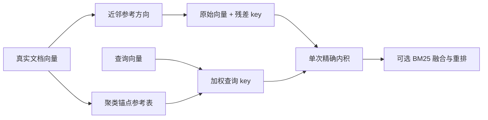

# 邻域残差检索：实现与首轮证伪

_2026-10-20；公开数据开发小试；未证明原创性或大知识库收益。_

## 🎯 结论与研究决策

已经实现单层邻域残差检索，并以真实 BGE 语义向量完成比较。开发集从
`0 / 0.1 / 0.25 / 0.5` 中选出的残差权重为 **0**。这版配置没有提供可采用的
质量收益，因此没有将它设为默认检索方式，也没有把它宣传为新原创算法。

这不是对完整 NEAR 方法的否定。本实现仅借鉴其邻域残差思想，缺少论文中的
多层结构与分数尺度校准；本文的证据仅针对下面这个配置。[^near]

先验证静态检索收益，再开展 `001-differentiation.md` 中的增量维护 C1。
本轮没有实现 C1，也不应在尚无静态收益时把维护成本优化当作检索效果突破。

## ⚙️ 已实现的算法

对单位文档向量 `v`，取 16 个其他文档近邻的均值方向 `a`，计算归一化残差
`r = normalize(v - dot(v,a) a)`。用 64 个球面聚类锚点及其参考方向构造查询
参考，查询只混合最近 4 个锚点。近零残差保留为零，避免放大浮点消减噪声。

文档 key 为 `[v, r]`，查询 key 为 `[(1-w)q, w*rq]`，一次内积得到两部分的
凸组合。`local_residual` 使用该分数，`residual_hybrid` 再与 BM25 融合。
SDK 和 CLI 均支持这两个可选模式。过滤先于截断，重排在最终 `top_k` 截断前运行。



索引构建为 **O(N²)** 的精确近邻计算，查询使用精确搜索。增删会全量重建。
这是有界原型，尚不适合直接用于百万分块；没有实现 ANN 或预算内增量刷新。

## 🧪 冻结协议

- BEIR SciFact：5,183 篇摘要，每篇一个块，标题加正文。只读取 train qrels；
  官方 test qrels 未解压、未使用。[^beir]
- 1,109 条查询中，919 条正相关标注覆盖 809 个查询 ID。seed=17 打乱后取
  160 个，前 40 个开发、后 120 个验证。仅按查询划分，不是来源文档隔离。
- 编码器：`BAAI/bge-small-en-v1.5`，FastEmbed 0.9.0，ONNX Runtime 1.31.0，
  384 维；分别调用 passage/query 接口，没有 HASH 回退。
- 每个检索来源取 50 个候选，融合后保留 50 个，最终 K=10。
- 仅以开发集 `residual_hybrid nDCG@10` 选择权重；并列取较小权重。
  其他参数固定，没有声称基线经过全面调参。
- 数据、向量缓存、ONNX 权重和运行源码均记录 SHA256；原始记录见
  [120 查询报告](results/scifact-pilot.json)。

## 📊 验证结果

| 方法 | Recall@10 | nDCG@10 | 候选 Recall@50 |
| --- | ---: | ---: | ---: |
| BM25 | 78.33% | 67.93% | 86.67% |
| BGE dense | 87.92% | 76.07% | 95.83% |
| BGE + BM25 | 89.58% | 75.60% | 94.58% |
| 残差混合，开发集选中 w=0 | 89.58% | 75.60% | 94.58% |
| 混合 + 词面重排 | 87.92% | 73.92% | 94.58% |

开发集残差混合 nDCG@10 随权重 `0 / .1 / .25 / .5` 分别为
`0.7299 / 0.7218 / 0.7149 / 0.7132`，因此没有越过开发决策规则启用残差。
验证结果相同是因为残差权重为零，不构成两个方法独立有效的证据。

修正后运行的单层索引构建约 0.28 秒，保留数组约 24.08 MB；该内存数字
不包含文本、Python 对象、模型及临时峰值。缓存查询向量后的组件 p50 为：
dense 约 0.44 ms、混合约 15.26 ms、残差混合约 15.36 ms。运行环境和原始
计时保存在报告中；这不是在线 API 延迟、吞吐或完整编码耗时。

候选 Recall@50 高于最终 Recall@10，说明这个小试仍有排序损失；混合候选
Recall 也低于单独 dense。它们是后续可检查的具体机制，不能从这一个数据集
外推为所有大知识库的主要问题。

在 120 条查询中，混合检索有 7 条查询在候选 50 中尚未覆盖全部已标注相关
文档，另有 7 条在候选到最终前 10 的过程中损失相关文档。更细的候选分配与
排序错误需要分别处理。

固定前 40 条查询的学习型重排序补充结果如下，使用相同候选预算：

| 方法 | Recall@10 | nDCG@10 | 候选 Recall@50 |
| --- | ---: | ---: | ---: |
| dense | 86.25% | 74.08% | 97.50% |
| dense + cross-encoder | 82.50% | 72.82% | 97.50% |
| 混合 | 85.00% | 71.67% | 96.25% |
| 混合 + cross-encoder | 82.50% | 70.51% | 96.25% |

原始分数、各方法 top IDs 和模型哈希见 [40 查询报告](results/scifact-cross-encoder.json)。
残差权重为零时，与对应混合方法结果相同。这个小型 MS MARCO 重排模型也没有
带来收益，不能据此否定所有学习型重排器；这里只能拒绝当前固定配置。

具体失败样例按各类中查询 ID 的字典序取前两条，避免只展示符合叙事的案例：

| 类别 | 查询 ID | 查询 | 已标注相关文档 ID |
| --- | --- | --- | --- |
| 候选未覆盖完整证据 | 1128 | T cell receptor /CD3 microdomains are required to induce the immunologic synapse. | 33499189, 9283422 |
| 候选未覆盖完整证据 | 173 | Bcp1 is a chaperone for Rpl23. | 8126244 |
| 候选有证据但最终排序丢失 | 0 | 0-dimensional biomaterials lack inductive properties. | 31715818 |
| 候选有证据但最终排序丢失 | 1067 | ScPif1p has higher binding ability to G-rich ssDNA than to non-G-rich ssDNA. | 4429668 |
| CE 后 Recall 下降 | 4 | 1-1% of colorectal cancer patients are diagnosed with regional or distant metastases. | 22942787 |
| CE 后 Recall 下降 | 486 | H4 G94P proteins inhibit chromatin assembly, which decreases free histones. | 14637235 |

查询原文来自公开数据，数值和措辞按源文件保留。这些失败标签只来自候选/最终
排名与 qrels 的比较，尚未证明具体成因是数字、否定、实体或关系识别错误。

## 🛠️ 复现与使用

```powershell
python -m pip install -e '.[research]'
python scripts/prepare_scifact.py
$env:OPENBLAS_NUM_THREADS='4'
$env:OMP_NUM_THREADS='4'
python scripts/benchmark_residual.py --commit <当前完整提交号>
python scripts/benchmark_cross_encoder.py --commit <当前完整提交号>
```

第二个脚本在事先固定的验证集前 40 条查询上，增加真正的学习型 cross-encoder
对照；只在该子集内部比较，不能直接与上表 120 条均值比较。它使用
`Xenova/ms-marco-MiniLM-L-6-v2`，无词面回退；并集只共享计算，各方法仍仅重排
各自原先的 50 个候选。模型会按 token 上限截断长文本。

```python
from velorag.pipeline import VeloRAG
from velorag.retrieval.residual import ResidualConfig

# settings 必须明确配置真实语义编码器；HASH 仅适合功能检查。
rag = VeloRAG(settings=settings, residual_config=ResidualConfig(weight=0.1))
rag.ingest_text(text, doc_id="document-1")
results = rag.search(query, mode="residual_hybrid", candidate_k=50, top_k=10)
```

`weight=0.1` 仅展示实验参数入口，不是本轮推荐值。已有持久化向量必须与
查询编码器一致，且后端须能提供完整快照。当前会在内存中恢复 BM25 语料，
并为实验索引读取完整向量。共享持久化集合的分片快照会去重，冲突则报错；
这不等于实现了独立的持久化分片体系。

## 🔍 审计、限制与下一道门槛

首轮审计发现四项问题：数值消减噪声、融合排序与分数不一致、持久化重载遗漏、
缺少查询计时；复查另发现共享分片重复与基线 sparse 重载不一致。均已修复并经
独立只读探针核验。修复前的运行被标记无效，只有向量缓存被复用。

目前不能声称：原创算法已经成立、百万知识库可扩展、中文资料有效、跨文档
多跳有效、答案正确率提升或生产可用。公开标注可能不完整，未标注文档按标准
评测记为不相关；本轮没有显著性推断，也没有测试集或业务数据验证。

下一道门槛是：明确失败样例，提出可区分的机制，在相同候选/重排预算和独立
数据上超过强基线，然后才讨论大规模索引与持续更新。前述 C1 仍为待验证假设。

[^near]: Luo et al. NEAR: Neighborhood-Aware Residuals for Memory Retrieval. https://arxiv.org/html/2610.13314v1
[^beir]: BEIR 官方仓库与 SciFact 数据入口。https://github.com/beir-cellar/beir
